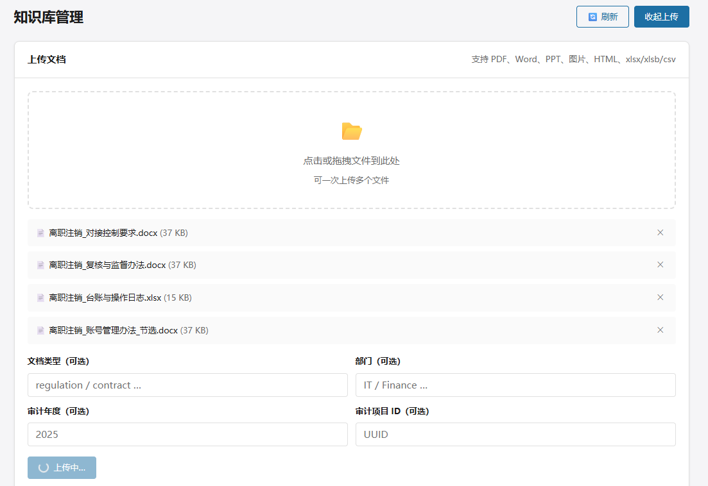
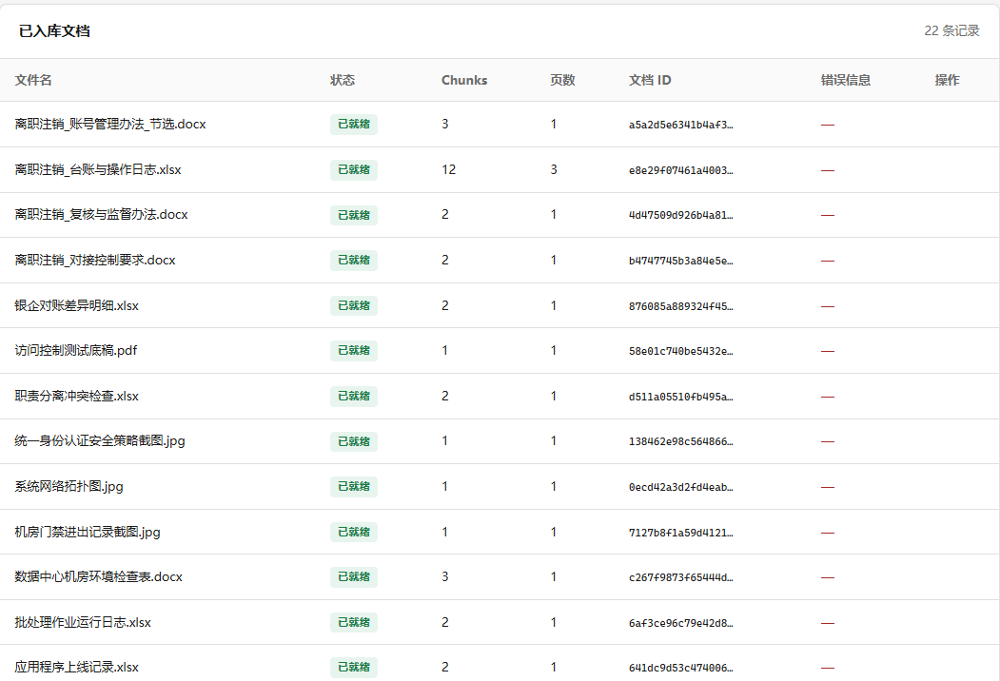
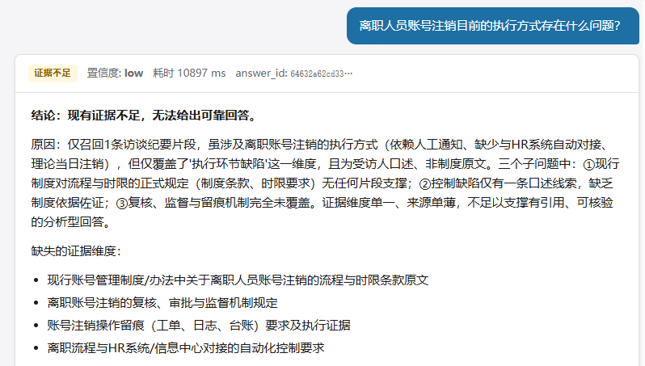
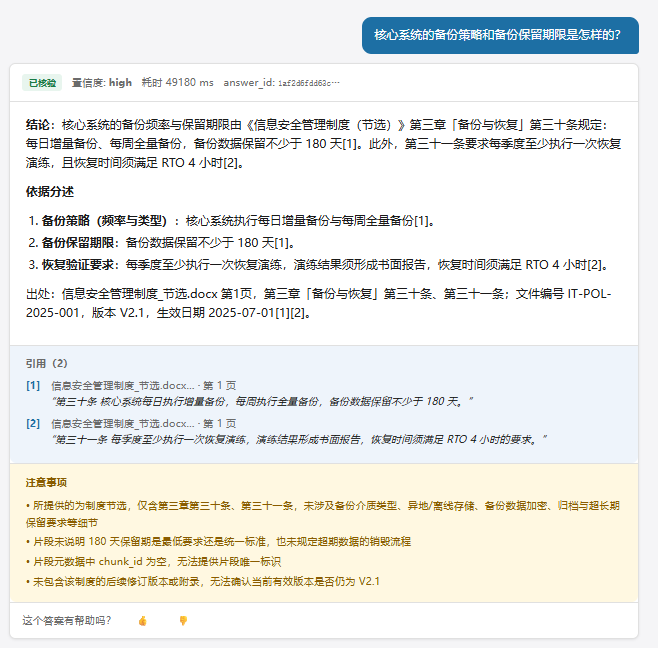
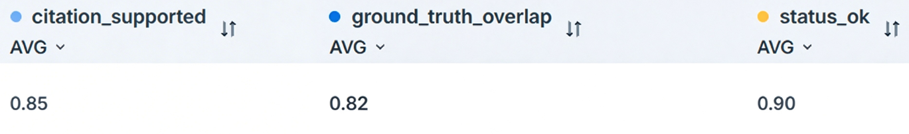

# 审计智能问答系统

面向审计场景的 RAG 问答：**问题分类 → 知识库检索 → 充分性判断 → 带引用生成 → 引用核验**。证据不足时明确告知，不编造答案。

> **仅供学习和研究使用，禁止任何商业用途。** 详见文末「许可」。

## 功能

- **问题拆解**：指代消解、子问题拆解、分类、检索查询改写
- **检索**：多查询召回 → 融合与 Rerank → 充分性判断，证据不足时自动补查
- **验证**：先做 quote 溯源（确定性检查），再逐条校验引用是否支持结论
- **知识库**：MinerU 解析文档，语义切分，bge-m3 向量化，Milvus 混合检索
- **运营**：多轮会话历史、👍/👎 反馈与坏例复核、导出为评估集

## 技术栈

LangGraph · FastAPI · PostgreSQL · Milvus · React · LangSmith · RAGAS

## 快速开始

前置条件：Docker、Python 3.12、Node.js，以及 [SiliconFlow](https://siliconflow.cn) 和 [MinerU](https://mineru.net) 的 API Key。

```bash
cp .env.example .env          # 填写 SILICONFLOW_API_KEY、MINERU_API_KEY
make up                       # 启动 PostgreSQL、Milvus 等基础设施
pip install -r requirements.txt
make migrate                  # 建表
make dev                      # API 启动于 http://localhost:8000/docs
```

另开一个终端启动前端：

```bash
cd frontend && npm install && npm run dev    # http://localhost:5173
```

常用命令：

```bash
make ingest FILES="docs/*.pdf"                        # 文档入库
make ask Q="采购审批权限是多少？"                         # 命令行提问
make check                                            # 检查各服务连通性
make eval DATASET=eval_datasets/it_audit_qa_50.yaml   # 离线评估
```

示例数据可用 `python -m scripts.generate_it_audit_samples` 生成到 `samples/it_audit/`，内容为虚构，仅用于测试。

## 截图

**知识库增量入库**




**证据不足时的回答**



**引用核验通过**



**评测结果**



## 许可

本项目仅用于个人学习和研究。**禁止将本项目及其衍生作品用于任何商业用途**，包括但不限于商业产品、付费服务和商业咨询。

- 示例数据为虚构，不代表任何真实单位的制度、台账或审计结论。
- 使用 SiliconFlow、MinerU、LangSmith 等第三方服务需遵守其各自的服务条款。
- 系统输出仅供参考，不能替代专业审计判断。
